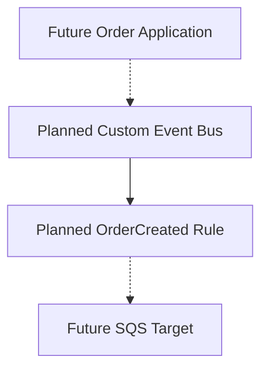
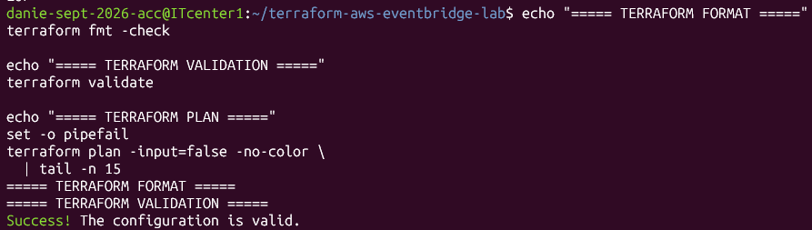

# Amazon EventBridge Terraform Lab

## Project Overview

This project demonstrates how to design and validate
Amazon EventBridge infrastructure using Terraform,
AWS CLI, Ubuntu Linux, and Git.

**Deployment status: PLAN ONLY — NOT DEPLOYED**

The configuration defines a custom EventBridge event
bus and an event-filtering rule in AWS us-east-1.

## Architecture



Solid connections represent relationships defined
in the Terraform configuration.

Dashed connections represent future integrations.

No resources have been deployed.

## Planned AWS Resources

| Resource | Count | Status |
|---|---:|---|
| Custom EventBridge event bus | 1 | Planned |
| EventBridge rule | 1 | Planned |
| EventBridge targets | 0 | Not configured |
| **Total** | **2** | **Plan only** |

## Technical Configuration

- AWS Region: us-east-1
- Event bus: terraform-eventbridge-lab
- Rule: terraform-order-created-rule
- Rule state: ENABLED when deployed
- Event source: lab.orders
- Event detail-type: OrderCreated

## Event Pattern

The rule matches events with:

- source = lab.orders
- detail-type = OrderCreated

Example event:

```json
{
  "source": "lab.orders",
  "detail-type": "OrderCreated",
  "detail": {
    "orderId": "ORDER-1001",
    "status": "created"
  }
}
```

This is an example event, not an actual
published event.

## Terraform Validation

Commands executed:

```bash
terraform fmt -check
terraform validate
terraform plan -input=false -no-color
```

Verified results:

- Formatting passed
- Configuration validation passed
- Plan: 2 to add, 0 to change, 0 to destroy

See [Validation Evidence](docs/validation-evidence.md).

## Deployment Limitations

- No Terraform apply was performed.
- No custom event bus was deployed.
- No EventBridge rule was deployed.
- No event targets were configured.
- No events were published or processed.
- No event delivery was tested.

## Security Considerations

- Protect AWS credentials.
- Do not commit Terraform state files.
- Use least-privilege IAM permissions.
- Review EventBridge resource policies.
- Restrict event publishers and targets appropriately.

## Cost Considerations

Terraform planning does not deploy these resources.

EventBridge usage may incur charges after deployment.

## Future Improvements

- Deploy the custom event bus.
- Deploy the event-filtering rule.
- Configure an SQS target.
- Configure permissions for event publishing.
- Test event matching and delivery.
- Add CloudWatch monitoring.

## Validation Screenshot


