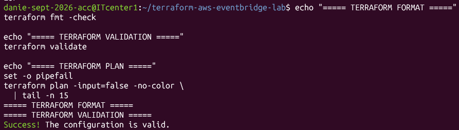

# Amazon EventBridge Validation Evidence

## Deployment Status

PLAN ONLY — NOT DEPLOYED

## Environment

- Ubuntu Linux (WSL2)
- AWS Region: us-east-1
- Terraform version: 1.17.0
- AWS CLI

## AWS Discovery Results

Default event bus: Present

Custom event buses: 0

Rules on default event bus: 0

## Planned Resources

1. aws_cloudwatch_event_bus.lab
2. aws_cloudwatch_event_rule.order_created

## Planned Configuration

Custom event bus:

terraform-eventbridge-lab

EventBridge rule:

terraform-order-created-rule

Event source:

lab.orders

Event detail-type:

OrderCreated

## Terraform Formatting

Command:

terraform fmt -check

Result:

Passed

## Terraform Validation

Command:

terraform validate

Result:

Success! The configuration is valid.

## Terraform Plan

Command:

terraform plan -input=false -no-color

Result:

Plan: 2 to add, 0 to change, 0 to destroy.

## Deployment Verification

Terraform apply was not executed.

No AWS resources were created by this lab.

No event delivery was tested.

## Screenshot

